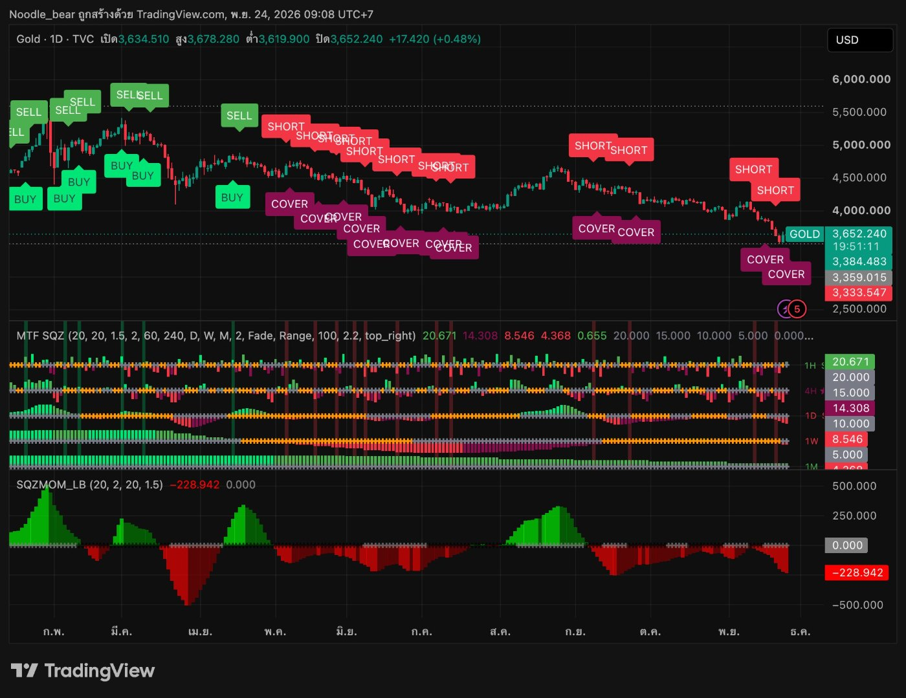

# trading

อินดิเคเตอร์และโน้ตสำหรับ TradingView (Pine Script v6)

## หน้าตา

Gold (TVC) กราฟรายวัน: แผงบนคือราคาพร้อมป้าย BUY / SELL / SHORT / COVER, แผงกลางคือ **MTF SQZ** (histogram 1H · 4H · 1D · 1W · 1M ซ้อนกัน), แผงล่างคือ **SQZMOM_LB** ภาพจับจาก TradingView วันที่ 24 พ.ย. 2026 ใช้เพื่อแสดงหน้าตาเท่านั้น ไม่ใช่ผล backtest

## Folder

| Path | ใช้เก็บอะไร |
|---|---|
| `pine/sqzmom_lazybear_v6.pine` | Squeeze Momentum ของ LazyBear เขียนใหม่เป็น v6 (ตรรกะเดิมทุกอย่าง) |
| `pine/mtf_sqzmom_v3.pine` | **MTF Squeeze Momentum v3**: histogram 5 time frame ซ้อนกันในแผงเดียว พร้อมสัญญาณ BUY / SELL / SHORT / COVER |
| `docs/sqzmom_guide.md` | คู่มือฉบับเต็ม: ตรรกะของ SQZMOM, วิธีอ่านป้าย, กฎเข้าออก, time frame ที่เหมาะ, วิธีติดตั้งและเผยแพร่ |

## ใช้งานเร็ว

1. เปิด tradingview.com แล้วเปิด Pine Editor → **Open → New indicator**
2. ลบโค้ดเดิมทิ้ง แล้ววางโค้ดจาก `pine/mtf_sqzmom_v3.pine`
3. กด **Save** แล้วกด **Add to chart** โดยตั้งกราฟเป็น **4H** ให้ตรงกับแถว trigger ที่เป็นค่าเริ่มต้น

## Credit & License

- ตรรกะ squeeze/momentum มาจาก **Squeeze Momentum Indicator [LazyBear]** ซึ่งอิงแนวคิด TTM Squeeze ของ John Carter
- โค้ดใน repo นี้ใช้สัญญาอนุญาต [Mozilla Public License 2.0](LICENSE)

> ⚠️ โค้ดยังไม่ได้ทดสอบรันใน TradingView และกฎเข้าออกยังไม่ได้ backtest ไม่ใช่คำแนะนำการลงทุน
